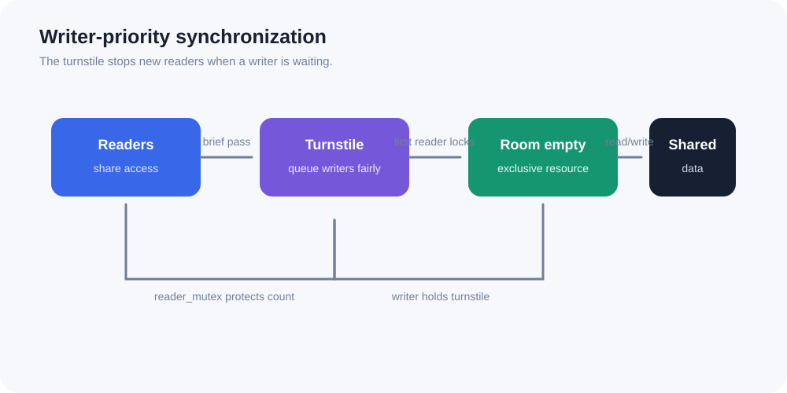

# Fair Reader-Writer Problem in C

[](https://github.com/kirantej5/reader-writer-problem/actions/workflows/ci.yml)
[](https://en.wikipedia.org/wiki/C11_(C_standard))
[](https://pubs.opengroup.org/onlinepubs/9699919799/)
[](LICENSE)

A practical operating-systems implementation of the **reader-writer synchronization problem** using C, POSIX threads, mutexes, and semaphores.



## What it demonstrates

- Multiple readers can access shared data concurrently.
- Writers receive priority when waiting, preventing writer starvation.
- Writers have exclusive access to the shared resource.
- A turnstile prevents newly arriving readers from overtaking a queued writer.
- The stress test detects simultaneous writers, reader/writer overlap, lost updates, and failed reader sharing.

## Synchronization strategy

The custom `rwlock_t` uses three primitives:

1. **`turnstile` semaphore** — writers close this gate while waiting, so new readers queue behind them.
2. **`room_empty` semaphore** — provides exclusive ownership of the shared resource to one writer or the reader group.
3. **`reader_mutex` mutex** — protects the active-reader counter. The first reader acquires `room_empty`; the last reader releases it.

This creates writer priority while still allowing a group of readers to proceed together. The lock is designed for threads within one process.

## Project structure

```text
reader-writer-problem/
├── include/rwlock.h       # Public lock API
├── src/rwlock.c           # Writer-priority lock implementation
├── src/main.c             # Configurable demonstration program
├── tests/test_rwlock.c    # Concurrent correctness stress test
├── docs/concurrency.svg   # Synchronization diagram
├── Makefile               # Build, test, and clean commands
└── .github/workflows/ci.yml
```

## Requirements

- Linux, macOS, or another POSIX-compatible system
- C11 compiler such as GCC or Clang
- POSIX threads and unnamed semaphores

## Build and run

```bash
make
./build/reader_writer
```

Customize the demo:

```bash
./build/reader_writer --readers 8 --writers 3 --iterations 100 --delay-ms 5
```

Options:

| Option | Default | Description |
|---|---:|---|
| `--readers N` | `4` | Number of reader threads |
| `--writers N` | `2` | Number of writer threads |
| `--iterations N` | `5` | Operations per thread |
| `--delay-ms N` | `25` | Delay between operations |

## Run the stress test

```bash
make test
```

The test performs 6,000 reads and 3,000 protected writes, verifies the final value, confirms that no reader overlaps a writer, confirms that no writers overlap, and verifies that multiple readers can share the resource.

## Example output

```text
Starting 4 readers and 2 writers for 5 iterations...
reader 1 observed value 0
writer 1 completed first update -> 1
...
Completed 20 reads and 10 writes. Final value: 10 (expected 10)
```

## Limitations and trade-offs

- This implementation targets POSIX systems; native Windows builds need WSL, MSYS2, or an equivalent POSIX layer.
- Writer priority prevents writer starvation but can delay a continuous stream of readers.
- Production code should define shutdown behavior and handle every synchronization error according to its recovery policy.

## License

MIT. See [`LICENSE`](LICENSE).
